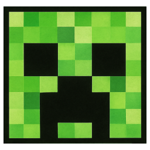
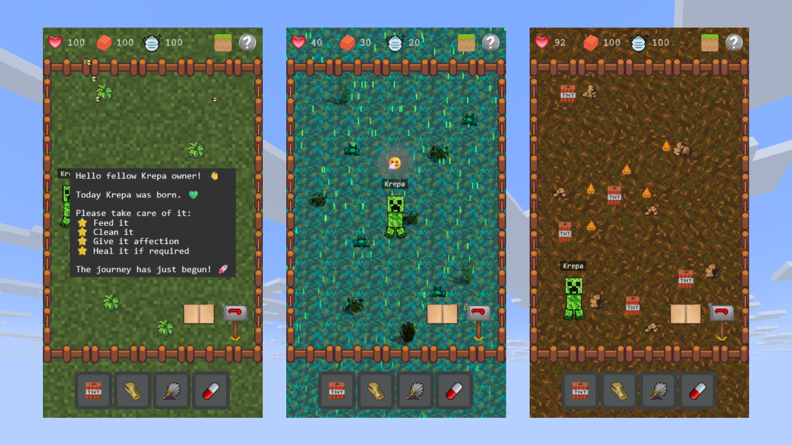

<h1 align="center">
    <br/>
    Krepagotchi
</h1>

<p align="center">
    A pixelated, adorable virtual pet game<br/>
    (C) 2025 - 2026 by Daniel Brendel<br/>
    <a href="https://www.danielbrendel.com">www.danielbrendel.com</a>
</p>

<p align="center">
    
    
    
    
</p>

<p align="center">
    
</p>

## Table of Contents

- [Description](#description)
- [Features](#features)
- [Install via Docker](#install-via-docker)
- [Install locally](#install-locally)
- [Make shippable builds](#make-shippable-builds)
- [Environment variables](#environment-variables)
- [Disclaimer](#disclaimer)

## Description

Krepagotchi is a virtual pet game where you take care of your own little Krepa. You can feed it, clean its home and provide medical treatment when sick.
You can also pet it or play with it (randomly selected ball game or bubble popping) in order to provide affection. Full hunger and zero affection levels as well as a dirty home will impact your pets health. If health reaches zero, your Krepa will fuse and detonate. When that happens you will be prompted with an info dialogue showing some text as well as date of birth and date of detonation, and the opportunity to restart with a new pet. The game has many cozy features and specials. It can be played as a web game or bundled as a standalone executable.

## Features
- Krepa pet
- Personal name
- Feeding
- Petting
- Playing
- Cleaning
- Treatment
- Health conditions
- Thought bubbles
- Send/receive letters
- Cozy Season Theme
- Birthday celebration
- New Year's Eve Party
- Biome selection
- Weather effects
- Dynamic environment
- Cute pixel art
- PWA support

## Install via Docker

Docker is the recommended way to install and deploy the project for production.

Clone the repository

```sh
git clone https://github.com/danielbrendel/krepagotchi-game
```

Switch into the new directory

```sh
cd krepagotchi-game
```

Edit the `docker-compose.yml` to fit your needs

```
nano docker-compose.yml
```

Pull the image and launch all containers

```sh
docker compose pull
docker compose up -d
```

The app should now be available via http://localhost:8080.

## Install locally

You can install the project locally, assuming you have a PHP and MySQL environment installed. This is recommended for development purposes.

Clone the repository

```sh
git clone https://github.com/danielbrendel/krepagotchi-game
```

Switch into the new directory

```sh
cd krepagotchi-game
```

Create a `.env` from `.env.example`, and configure it to fit your needs

```sh
cp .env.example .env
```

Install all dependencies

```sh
composer install
```

Perform a fresh database migration

```sh
php asatru migrate:fresh
```

Launch the development server

```sh
php asatru serve
```

The app should now be available via http://localhost:8000.

## Make shippable builds

**Note: You must install the project for local development before you can make game builds.**

Make a release build
```sh
php asatru game:release [platform]
```

Make a debug build
```sh
php asatru game:debug [platform]
```

`platform` can be one of the following:
- html5 (default)
- windows
- linux
- macos

The ready-packaged game builds are stored in the `/public/builds` directory

## Environment variables

This section covers all required project environment variables.

| Setting  | Description | Default |
| ------------- | ------------- | ----- |
| APP_GAMERESX  | Specifies the width of the game viewport  | 360 |
| APP_GAMERESY  | Specifies the height of the game viewport  | 640 |
| APP_ENABLELETTERS  | Define whether the letter feature shall be enabled or not  | true |
| APP_BACKEND  | Specify the URL to the letter backend. Use your own, or a public one  | http://localhost:8080 |
| APP_MAXCOUNT_PICK  | Define how many letters clients may pick per day  | 3 |
| APP_MAXCOUNT_ADD  | Define how many letters clients may send per day  | 2 |
| APP_ACCESSTOKEN  | Access token to be used for cronjobs  | access-token |
| APP_TIMEZONE  | Specify your time zone  | UTC |
| APP_DEBUG  | Whether the app shall run in debug mode or not  | false |
| APP_UPDATEDEPS  | Set to true to update composer dependencies upon each app container launch  | false |
| APP_ALWAYSONTOP | For Windows builds: Specify if the app shall stay on top of the screen | false |
| KREPA_INITIAL_HEALTH  | Initial pet health value when starting with a new pet  | 90 |
| KREPA_INITIAL_AFFECTION  | Initial pet affection value when starting with a new pet  | 70 |
| KREPA_INITIAL_FULLNESS  | Initial pet fullness value when starting with a new pet  | 50 |
| LOG_ENABLE  | Specify whether app logging shall be enabled or not  | true |
| DB_HOST  | Specify database hostname or address  | db (for docker environment) |
| DB_PORT  | Specify database connection port  | 3306 (for docker environment) |
| DB_DATABASE  | Specify name of the database to be used  | krepagotchi |
| DB_USERNAME  | Specify the user name of your database credentials  | user (for docker environment) |
| DB_PASSWORD  | Specify the user password of your database credentials  | password (for docker environment) |
| DB_CHARSET  | Specify the charset to be used for database queries  | utf8mb4 |

## Disclaimer

This project is a fan-made game and is not affiliated with Mojang, Microsoft, Bandai, or any of their properties.
